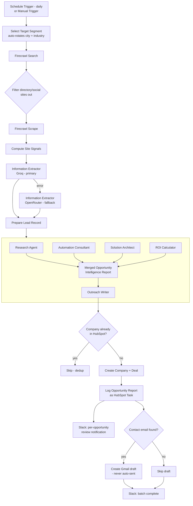

# True Digital - AI Growth Agent

An autonomous prospecting and opportunity-intelligence system that finds businesses with visible, fixable growth gaps - weak SEO, unclaimed Google Business Profiles, missing marketing automation - scores the commercial opportunity, and produces a human-approved, personalized outreach draft. Built to give a solo agency operator the prospecting throughput of a small BDR team, on free/low-cost infrastructure.

## Problem

Small and mid-sized businesses rarely self-diagnose their own digital growth gaps, and generic cold outreach doesn't work on them. Manual prospecting - researching a company, identifying what's actually broken, estimating a believable ROI, and writing a personalized first message - takes 30–45 minutes per prospect by hand. That caps outbound volume at a level too low to build a pipeline. This system collapses that to under 3 minutes of human review time per opportunity, with every send still gated by human approval.

## Architecture

Two orchestrators coordinate five specialized sub-agents. Orchestrator 1 owns discovery, enrichment, and CRM writes; Orchestrator 2 owns analysis, scoring, and outreach drafting. Splitting them keeps each orchestrator's context window focused - discovery never sees pricing/ROI logic, and analysis never handles raw scraping.



Every LLM call in the pipeline (6 call sites total: extraction + 4 analysis sub-agents + outreach drafting) runs on Groq by default and fails over to OpenRouter automatically on error or rate limit - this has caught real Groq rate-limit failures in production without stalling the batch.

## Tech Stack

| Layer | Tool |
| --- | --- |
| Orchestration | n8n (Cloud) |
| Search + scraping | Firecrawl |
| Primary LLM | Groq (`openai/gpt-oss-20b`) |
| Fallback LLM | OpenRouter (`nvidia/nemotron-3.5-lightning:free`) |
| Structured output | LangChain Information Extractor nodes, JSON schema enforced per agent |
| CRM | HubSpot (company / contact / deal / task objects) |
| Outreach | Gmail API - draft-only scope, send permission deliberately not granted |
| Notifications | Slack |

## Sub-Agents

| Agent | Responsibility |
| --- | --- |
| Research Agent | Extracts SEO score, load speed, GBP/LinkedIn/Instagram presence from scraped site signals |
| Automation Consultant | Reasoning chain: Observation → Reasoning → Problem → Primary Pain Point, grounded only in the Research Agent's data |
| Solution Architect | Maps the pain point to a service-catalog pattern (6-industry automation pattern library) |
| ROI Calculator | Produces a conservative hours-saved and ROI range - never a single point estimate |
| Outreach Writer | Drafts a 5-part, no-placeholder first-touch message referencing only verified data points from the report |

## Sample Opportunity Intelligence Report (redacted)

```
Company: [Example Skin Clinic]
Confidence Score: 80/100

BUSINESS OVERVIEW
SEO Score: 100/100
Load Speed: 3.5s
Google Business Profile Claimed: false

PAIN POINT
Observation: GBP has not been claimed.
Reasoning: Without a claimed Google Business Profile, the clinic appears
less in local search results, reducing potential patient inquiries.
Primary Pain Point: Unclaimed Google Business Profile limiting local
search visibility.

RECOMMENDED AUTOMATION
Opportunity: Claim and optimize Google Business Profile, integrate
Lead-Capture Automation to convert increased visibility into booked
appointments.
Priority: 4

ROI
Estimated Hours Saved/Month: 15
Estimated ROI: 2 to 5 additional booked calls/month

NEXT ACTION
20-minute free automation audit call
```

## Proof of work - a real run (27 Aug 2026)

Pulled directly from production executions, not a staged demo (this is the same run shown in the video walkthrough). The Schedule Trigger fired at 9:00 AM IST; Orchestrator 1 found 2 new leads, and each one ran the full Orchestrator 2 chain automatically:

| Lead | SEO score | Primary pain point | ROI estimate | Draft ready in |
| --- | --- | --- | --- | --- |
| Apollo Dental | 80 | No Google Business Profile claimed | 8 hrs/mo saved, 5-15 additional booked calls/mo | 29s (Groq succeeded on 3rd attempt after 2 rate-limit errors) |
| Partha Dental | 55 | No Google Business Profile claimed | 4 hrs/mo saved, 1-3 additional appointments/mo | 129s (Groq failed entirely; completed via automatic OpenRouter failover) |

Both went from raw discovery through all five sub-agents to a Gmail draft, with zero manual intervention and zero lost records - including the case where Groq failed outright and the system had to fail over mid-chain. Sample drafted output (Apollo Dental):

> **Subject:** Boost Apollo Dental's Local Search with GBP
>
> Hi there, Apollo Dental - we've noticed your practice could benefit from a stronger local presence, especially in a competitive market.
>
> Apollo Dental is missing out on local search traffic because they have not claimed their Google Business Profile, and their site loads in 3.5 seconds, which can deter patients who expect fast online experiences.
>
> - Claim and optimize the Google Business Profile to boost local search visibility and attract new patients.
> - 8 hours saved and 5 to 15 additional booked calls per month.
>
> Worth a quick 20-minute free automation audit call this week?
>
> Surya, True Digital

## Reliability

- **Existence-check-before-write** - every business is checked against HubSpot by domain before any company/deal is created, preventing duplicate CRM records across repeated runs.
- **Explicit LLM fallback** - n8n's Information Extractor node doesn't support native multi-model failover despite its type signature suggesting otherwise (confirmed via `DUPLICATE_SUBNODE_CONNECTION` at runtime). Fallback is instead built explicitly: primary node set to `continueErrorOutput`, wired to a duplicate node bound to the fallback model on the error branch.
- **Draft-only outreach** - the Gmail node has draft scope only. There is no code path in the workflow that can send a message; approval is architectural, not a prompt instruction.
- **Human review, not just a batch summary** - every opportunity gets its own Slack notification (business name, confidence score, pain point, ROI, next action) rather than a single end-of-batch count, so review stays under 3 minutes per item.

## Roadmap

- Real SEO/GBP/LinkedIn API sourcing - currently LLM-estimated from scraped site content rather than pulled from SEMrush/Ahrefs/Google Business Profile APIs.
- Persistent Memory / Learning History store (Supabase) - no calibration feedback loop from outreach outcomes back into scoring yet.

## Setup

1. Import the two orchestrator workflows and five sub-agent workflows into n8n.
2. Configure credentials: Firecrawl API key, Groq API key, OpenRouter API key, HubSpot private app token, Gmail OAuth2 (draft scope only), Slack OAuth2.
3. Edit the target segment list in the `Select Target Segment` code node (service + city + state combos) to match your ICP.
4. Set the Schedule Trigger cadence, or run manually for an ad hoc batch.

## Demo

*(video walkthrough - 


)*

https://github.com/user-attachments/assets/c0fd4052-2759-4ea0-abbf-f0f9c6542c35


---

*Built by Surya, True Digital.*
