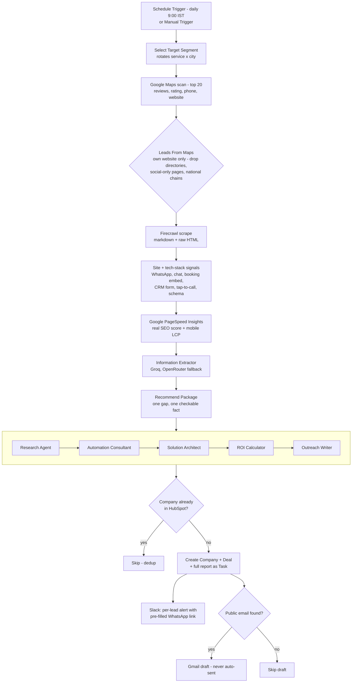

# True Digital - AI Growth Agent

A multi-agent prospecting system for local businesses. Every day it finds real businesses on Google Maps, checks what is genuinely weak in their online presence using measured data, picks one clear pitch, and prepares a WhatsApp message (and an email draft when a public address exists) for me to review and send. Nothing is ever sent automatically.

Built so a solo agency operator gets the prospecting throughput of a small BDR team, on free/low-cost infrastructure.

## Demo (2 minutes)

A real production run from 15 Oct 2026 - dental clinics in Nellore, India. Every number shown comes from that run.

https://github.com/user-attachments/assets/c0fd4052-2759-4ea0-abbf-f0f9c6542c35

## Problem

Small local businesses rarely self-diagnose their digital gaps, and generic cold outreach doesn't work on them. Researching one business by hand - finding them, checking their site, comparing them with competitors, writing a personal first message - takes 30-45 minutes. That caps outbound volume too low to build a pipeline. This system does the research automatically and leaves me about 3 minutes of review per lead, with every send still in my hands.

## Architecture

Two orchestrators and five specialist sub-agents. Orchestrator 1 owns discovery, measurement, the local pitch and CRM writes; Orchestrator 2 owns the deeper AI analysis and the email draft.



Every LLM call (6 call sites: extraction + 5 sub-agents) runs on Groq first and fails over to OpenRouter automatically on error or rate limit.

## How a lead is qualified and pitched

1. **Real businesses only.** Leads come from Google Maps listings, not web search. Listings without their own website, Facebook/Instagram-only pages, directories (Justdial, Practo, listicles) and national chains are dropped. Businesses with no website at all are handled by a separate workflow that pitches a website.
2. **Measured, not guessed.** SEO score and mobile load time come from Google PageSpeed Insights. Contact channels, booking systems and analytics are detected from the site's raw HTML. Each signal carries a flag saying whether it was actually measured, and agents are not allowed to cite unmeasured values as facts.
3. **One pitch per lead, one checkable fact.** The local pitch is chosen deterministically (no LLM) from the first real gap found:
   - **Google Growth** - fewer Google reviews than a nearby competitor, not found in the top Maps results, or weak local SEO
   - **Never Miss an Enquiry** - the site asks people to enquire or book, but nothing replies instantly (no WhatsApp or chat)
   - **Appointment Reminders** - offered as an add-on for appointment-based businesses
4. **Human approval is architectural.** The WhatsApp message is a pre-filled `wa.me` link I open and send myself. The Gmail credential has draft scope only - there is no code path that can send.

## Proof of work - a real run (15 Oct 2026)

Segment: dental clinics in Nellore. Google Maps returned 20 clinics; 5 qualified. All 5 ran the full pipeline end to end in about 10 minutes (including a deliberate 35-second pause between leads), with zero manual steps.

| Clinic | Google reviews | PageSpeed SEO | Mobile LCP | Pitch chosen |
| --- | --- | --- | --- | --- |
| Smile Super Specialty Dental Hospital | 2,380 | 91 | 31.4s | Never Miss an Enquiry |
| Care International Dental Hospital | 2,198 | 100 | 27.4s | Never Miss an Enquiry |
| Dr. G. Konda Reddy Dental | 505 | 85 | 6.2s | Google Growth |
| Partha Dental Nellore | 564 | 92 | 3.3s | Google Growth |
| Dr. Swaroop's Dental | 519 | 73 | 0.8s | Google Growth |

### Sample lead - Partha Dental Nellore (from the same run)

```
LOCAL PITCH
Package: Google Growth
Why: 564 Google reviews vs Care International Dental Hospital's 2,198
Also offer: Appointment Reminders
Site: WhatsApp button yes | Tap-to-call yes | LocalBusiness schema yes

MEASURED SIGNALS
PageSpeed SEO score: 92/100 (measured)
Mobile load (LCP): 3.3s (measured)

DEEPER AI ANALYSIS (Orchestrator 2)
Primary gap: Contact form present but not connected to any CRM or automation
Secondary gap: Booking is mentioned on the site, but no real booking system is embedded
Recommended: Lead-capture automation + appointment reminder sequence
ROI estimate (AI, conservative range): 1 to 3 additional booked appointments/month
Confidence: 85/100
```

WhatsApp message prepared for review (exactly as generated):

> Hi, this is Surya from True Digital, Nellore.
>
> On Google Maps for "dental clinics in Nellore", CARE INTERNATIONAL DENTAL HOSPITAL has 2,198 reviews and Partha Dental Nellore has 564. Most patients pick the one with more reviews.
>
> I help local businesses get more enquiries from Google. Want me to send you 3 quick fixes for free? Just reply YES.

Partha also lists a public email address, so a Gmail draft with the deeper automation findings was created as well.

## Tech Stack

| Layer | Tool |
| --- | --- |
| Orchestration | n8n (Cloud) |
| Lead source | Google Maps via SearchApi |
| Scraping | Firecrawl (markdown + raw HTML) |
| Site measurement | Google PageSpeed Insights API |
| Primary LLM | Groq (`openai/gpt-oss-20b`) |
| Fallback LLM | OpenRouter (`nvidia/nemotron-3.5-lightning:free`) |
| Structured output | LangChain Information Extractor nodes, schema enforced per agent |
| CRM | HubSpot (company / contact / deal / task) |
| Outreach | WhatsApp click-to-chat links (`wa.me`) + Gmail API, draft-only scope |
| Notifications | Slack |

## Sub-Agents

| Agent | Responsibility |
| --- | --- |
| Research Agent | Builds the company profile; copies measured PageSpeed and HTML signals directly and flags anything unmeasured |
| Automation Consultant | Observation -> Reasoning -> Problem chain; picks the top two real gaps, grounded only in the Research Agent's data |
| Solution Architect | Maps the gap to a service-catalog pattern |
| ROI Calculator | Conservative hours-saved and ROI range - never a single point estimate |
| Outreach Writer | Drafts the email using only verified data points from the report |

## Reliability

- **Existence-check-before-write** - every business is checked against HubSpot by domain before any company/deal is created, so repeated runs don't create duplicates.
- **Explicit LLM fallback** - n8n's Information Extractor doesn't support native multi-model failover (confirmed via `DUPLICATE_SUBNODE_CONNECTION` at runtime). Fallback is built explicitly: the primary node uses `continueErrorOutput`, wired to a duplicate node bound to the fallback model.
- **Draft-only outreach** - there is no code path in the workflow that can send a message.
- **Per-lead human review** - every lead gets its own Slack alert with the pitch, review comparison, site checks and the WhatsApp link.

## What broke, and what I fixed

Being honest about failures is part of building with LLMs:

- **An agent reported a finding it had no data for.** An earlier version of this README and its demo video showed "Google Business Profile not claimed" as the main pain point. The pipeline had no Google Business Profile data source at all - the model filled in a default and presented it as a finding. I removed it as a pain point, marked the field as unverified, and added `measured` flags so agents can't present guesses as facts. That earlier demo has been replaced with the run above.
- **Two-thirds of "leads" weren't real businesses.** Web search returned directories, listicles and national chains. An audit of 4 days found only 4 real local businesses out of 12. Switching the lead source to Google Maps listings with their own website fixed it - the same days' data yields 14 real businesses.
- **A silent filter bug dropped every lead.** `new URL()` isn't available in n8n's Code node sandbox, and a `try/catch` hid the error, so one run found 20 clinics and passed on zero. Replaced with plain string parsing and re-tested with `URL` disabled to mirror the sandbox.

## Known limitations / Roadmap

- No Google Business Profile data source yet - that field is never used as a pain point.
- The WhatsApp message (local pitch) and the email draft (deeper automation analysis) can lead with different findings; aligning both on one hook is next.
- ROI figures are conservative AI estimates, not measurements.
- No feedback loop yet from outreach replies back into scoring.

## Setup

1. Import the two orchestrator workflows and five sub-agent workflows into n8n.
2. Configure credentials: SearchApi (Google Maps), Firecrawl, Google PageSpeed Insights API key, Groq, OpenRouter, HubSpot private app token, Gmail OAuth2 (draft scope only), Slack.
3. Edit the service and city lists in the `Select Target Segment` code node to match your market.
4. Set the Schedule Trigger cadence, or run manually for an ad hoc batch.

---

*Built by Surya, True Digital.*
